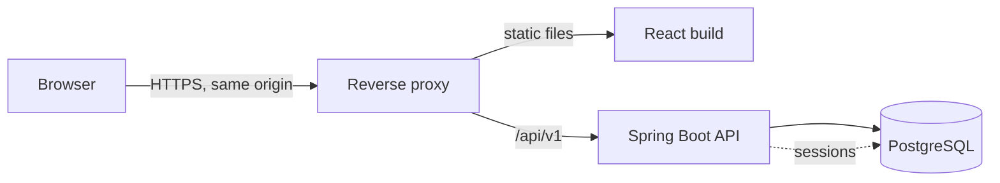

# CommerceFlow

An e-commerce web application: a React storefront and a Java Spring Boot backend with PostgreSQL, built sprint by sprint with a written design baseline, change control and automated tests.

**Status:** Sprint 4 released; Sprint 5 (administration and stock visibility) is in review. The live demo at https://khai-shop.vercel.app covers the catalog, guest and member carts, idempotent checkout with demonstration payments, order history and order tracking, on top of session authentication behind HTTPS. Try it with the [demonstration guide](docs/DEMO-GUIDE.md); see the [current status](docs/STATUS.md).

## Features

| Area | Status |
| --- | --- |
| Storefront UI: home, catalog with filters, product, cart and checkout | Done (Sprint 2); catalog served by the API since Sprint 3 |
| Registration, login, logout, session restoration | Done (Sprint 1B) |
| Role-based access (CUSTOMER, ADMIN) | Done (Sprint 1B) |
| CSRF protection, secure session cookie, session rotation | Done (Sprint 1B) |
| HTTPS same-origin integration and E2E tests | Done (Sprint 1C) |
| Public catalog API (categories, search, filters, sorting, paging) on PostgreSQL | Done (Sprint 3) |
| Guest and member cart, idempotent checkout with demonstration payment, order history, guest order tracking | Done (Sprint 4) |
| Administration: orders (ship, deliver, cancel with stock restore), stock and product editing, audit log | Done (Sprint 5) |

## Tech stack

| Layer | Technology |
| --- | --- |
| Frontend | React 18, TypeScript, Vite, Tailwind CSS, React Router, Redux Toolkit, Redux-Saga, Axios |
| Backend | Java 21, Spring Boot 3.5, Spring Security, Spring Session JDBC, Spring Data JPA |
| Database | PostgreSQL 17, Flyway migrations |
| Testing | Vitest and React Testing Library; JUnit 5 with Testcontainers; Playwright with Chromium over HTTPS |
| Infrastructure | Vercel (frontend), Render free web service (API, Docker), Neon free PostgreSQL; Docker Compose and Caddy for HTTPS integration tests; GitHub Actions |

## Architecture



## Repository layout

| Path | Contents |
| --- | --- |
| `frontend/` | React storefront (Vite, TypeScript, Tailwind CSS) |
| `backend/` | Spring Boot API with Flyway migrations |
| `e2e/` | HTTPS integration environment and Playwright browser tests |
| `docs/` | Requirements, architecture, API contracts, sprint records and decisions |
| `render.yaml`, `vercel.json` | Hosting configuration for the API and the storefront |

Key decisions (session authentication, same-origin deployment, crash-safe idempotent checkout, mock payments) are listed in the [decision log](docs/DECISIONS.md).

## Getting started

### Frontend

Requires Node 22.12 or later (CI uses Node 24).

```sh
cd frontend
npm ci
npm run dev               # development server on http://localhost:3000; /api/v1 is proxied to :8080
npm run typecheck
npm run lint
npm test
npm run build             # output in frontend/build/
```

### Backend

Requires JDK 21 and Docker. See [backend/README.md](backend/README.md) for configuration.

```sh
cd backend
cp .env.example .env      # set a local database password
docker compose --env-file .env up -d --wait
./mvnw clean verify
./mvnw spring-boot:run    # API on http://localhost:8080/api/v1
```

### End-to-end tests (HTTPS)

Requires Linux Docker Engine with Compose v2. See the [runbook](docs/testing/e2e-https-integration.md).

```sh
npm ci --prefix e2e
npm run --prefix e2e test:infra
bash e2e/scripts/run.sh local-<unique-run-id>   # needs frontend/build and the backend jar
```

## Deployment

The storefront is served by Vercel, which forwards `/api/v1` to the API on Render; PostgreSQL runs on Neon. All are free plans. Setup and operations: [docs/DEPLOYMENT.md](docs/DEPLOYMENT.md).

## Continuous integration

| Workflow | Runs |
| --- | --- |
| `frontend-ci.yml` | Type check, lint, Vitest tests and production build |
| `backend-ci.yml` | `mvn clean verify` with PostgreSQL Testcontainers; fails if integration suites are skipped |
| `integration-e2e.yml` | Full HTTPS stack with Playwright Chromium (18 scenarios: authentication, guest checkout, member checkout and administration) and guaranteed cleanup |

## Documentation

Contributors start at [AGENTS.md](AGENTS.md). Project documentation starts at [docs/README.md](docs/README.md): requirements, architecture, API contracts, test plans, sprint reports and the decision log.

## Branches

`develop` is the integration branch; `master` is protected and receives reviewed releases only. Work happens on `feature/*`, `fix/*` and `docs/*` branches through pull requests into `develop`.

## Local environment files

`.env` files are ignored and must never be committed; `.env.example` files hold placeholders only.

## Project information

- **Author:** Lam Khai
- **Repository:** https://github.com/lamkhai0604/commerceflow
