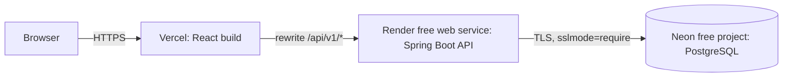

# Deployment — CommerceFlow

Decisions: S3-D01 (free-tier hosting), S3-D02 (single origin through Vercel), D3 (sessions, cookies, CSRF).

## Current services

| Service | Address |
| --- | --- |
| Storefront (Vercel production) | `https://khai-shop.vercel.app` |
| API (Render) | `https://commerceflow-api-4cx8.onrender.com` (reached through the storefront's `/api/v1`) |
| Database (Neon) | Project `commerceflow`, AWS US East; connection details only in the Render dashboard |

## Topology

The browser only talks to the Vercel origin. Vercel forwards `/api/v1/*` to the Render service (`vercel.json`), so the `SESSION` cookie is first-party for the storefront domain and the CSRF design is unchanged.

| Component | Plan | Behaviour to expect |
| --- | --- | --- |
| Vercel | Hobby | Deploys `master` to production and every branch to a preview |
| Render web service `commerceflow-api` | Free | Sleeps after 15 minutes without traffic; a cold start then takes about two minutes (121–135 s measured on 2026-11-08). The storefront retries read requests and shows "Starting the server" meanwhile |
| Neon project | Free | 1 GB storage; compute suspends when idle and resumes on the next connection |

## One-time setup (Product Owner)

Secrets are entered only in the provider dashboards. They are never committed, pasted into chat, or written to logs.

### 1. Neon database

1. Sign in at neon.com (GitHub sign-in is fine) and create a project named `commerceflow`, PostgreSQL 17, region **AWS US East (N. Virginia)**.
2. Open **Connect**, turn **Connection pooling off** (Flyway needs a direct connection), and note the host, database name, role and password.
3. Build the JDBC URL: `jdbc:postgresql://<host>/<database>?sslmode=require`.

### 2. Render API service

Prerequisite: `render.yaml` and `backend/Dockerfile` are on `master`.

1. Sign in at render.com with GitHub and allow access to `lamkhai0604/commerceflow`.
2. **New → Blueprint**, choose the repository; Render reads `render.yaml` and proposes the service `commerceflow-api` on the **Free** plan.
3. Enter the three values when asked: `SPRING_DATASOURCE_URL` (the JDBC URL above), `POSTGRES_USER` (the Neon role) and `POSTGRES_PASSWORD`. Apply.
4. Wait for the first build (several minutes). Open `https://<service URL>/api/v1/health`; it must return `{"status":"UP"}`. Flyway creates the schema and the demonstration catalog on first start.
5. Render appends a suffix when the service name is already taken. The rewrite destination in `vercel.json` must match the service's actual URL.

### 3. Verification on the production site

| Check | Expected |
| --- | --- |
| `https://<site>/api/v1/health` | `{"status":"UP"}` through Vercel |
| Home and Shop all | Products and rooms load; after a long idle period the "Starting the server" notice appears first |
| Create account, log in, reload, log out | Each step confirms; the account name stays after reload |
| Browser developer tools → Cookies | `SESSION` is Secure, HttpOnly, SameSite=Lax, Path=/ on the storefront domain |

## Operations

- **Deploys:** merging to `master` deploys both Vercel and Render (Render `autoDeploy`). Database migrations run on API start; they must stay backward compatible with the previous API version during the switch.
- **Logs:** Render dashboard → service → Logs. Application logs contain request IDs, not request bodies or credentials.
- **Rotating the database password:** reset it in Neon, update `POSTGRES_PASSWORD` in Render, then redeploy the service.
- **Recovery:** Neon keeps a short restore window on the free plan (Neon dashboard → Restore). Demonstration catalog data can always be recreated by migrations on an empty database.
- **Cost:** all three services are on free plans (S2-D07). Upgrades need a Product Owner decision.
